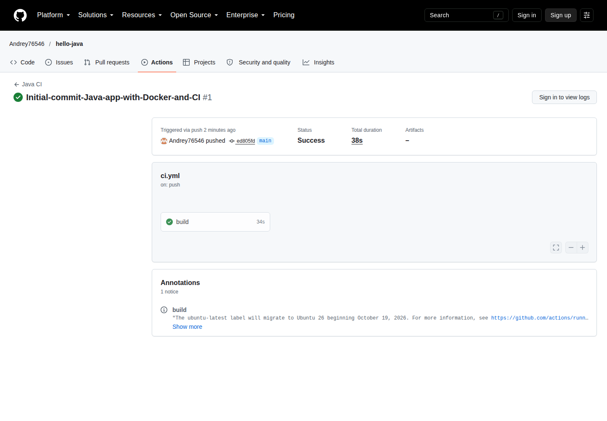

# Лабораторная работа: Hello Java — CI

## Цель работы

Освоить Maven и Java CI: собрать приложение на Java 17, выполнить тесты JUnit 5, создать исполняемый fat JAR, собрать минимальный multi-stage Docker-образ и автоматизировать проверки в GitHub Actions.

Оригинальное задание: [Pipeline CI на Java в GitHub Actions](https://github.com/rurewa/imfua/blob/main/content/DevOps/CI_CD/Pipelines/hello_java.md).

## Использованные технологии

- Java 17 (Eclipse Temurin);
- Apache Maven 3.9;
- JUnit 5.10.2;
- Maven Surefire Plugin 3.2.5;
- Maven Shade Plugin 3.5.2;
- Docker с multi-stage build;
- GitHub Actions.

## Реализация

Приложение выводит приветствие, фактическую версию Java, имя ОС и переданные аргументы. Maven компилирует проект, запускает два JUnit-теста и формирует исполняемый `target/hello-java.jar`. Dockerfile собирает JAR в образе Maven, а запускает его в компактном `eclipse-temurin:17-jre-alpine`.

Workflow `Java CI` запускается при push в `main`, pull request и вручную. Он устанавливает JDK 17, выполняет `mvn clean verify`, собирает Docker-образ и действительно запускает контейнер.

## Структура проекта

```text
hello-java/
├── .github/workflows/ci.yml
├── screenshots/
│   └── github-actions-success.png
├── src/
│   ├── main/java/Hello.java
│   └── test/java/HelloTest.java
├── .gitignore
├── Dockerfile
├── pom.xml
└── README.md
```

## Запуск и тестирование

Сборка и тесты без установки Maven на хост:

```powershell
docker run --rm `
  -v "${PWD}:/app" `
  -w /app `
  maven:3.9-eclipse-temurin-17 `
  mvn clean verify
```

Сборка и запуск приложения:

```powershell
docker build -t hello-java .
docker run --rm hello-java
```

Фактический локальный вывод контейнера:

```text
Hello from Java in Docker! ☕🐳
Java version: 17.0.20.1
OS: Linux
```

## Результаты проверки

- `mvn clean verify`: `BUILD SUCCESS`, выполнено 2 теста, ошибок и падений нет;
- fat JAR `target/hello-java.jar`: создан;
- Docker image `hello-java:lab`: собран;
- контейнер: завершился с кодом 0 и вывел ожидаемые Java 17/Linux;
- GitHub Actions: [успешный запуск Java CI №1](https://github.com/Andrey76546/hello-java/actions/runs/40294162039).

## Скриншот



## Соответствие требованиям преподавателя

| Требование преподавателя | Реализация | Способ проверки | Результат |
|---|---|---|---|
| Структура Maven-проекта | `pom.xml`, `src/main/java`, `src/test/java` | Просмотр дерева файлов | Выполнено |
| Java 17 | Compiler source/target 17 и Temurin 17 | Вывод контейнера | `17.0.20.1` |
| JUnit 5 и два теста | `HelloTest.java` | `mvn clean verify` | 2/2 успешно |
| Исполняемый fat JAR | Maven Shade Plugin с `mainClass=Hello` | Maven package/verify | JAR создан |
| Multi-stage Docker | Maven builder + Temurin JRE Alpine | `docker build` | Образ собран |
| Запуск приложения в контейнере | `ENTRYPOINT java -jar app.jar` | `docker run --rm hello-java:lab` | Код 0, ожидаемый вывод |
| GitHub Actions | `.github/workflows/ci.yml` | Публичный Actions run | Success |
| Push, pull request и ручной запуск | `push`, `pull_request`, `workflow_dispatch` | Проверка workflow | Настроено |
| Минимальные permissions | `contents: read` | Проверка workflow | Выполнено |

## Вывод

Java-приложение воспроизводимо собирается и тестируется в Maven, запускается в минимальном Docker-образе, а те же обязательные проверки автоматически выполняются в GitHub Actions.
